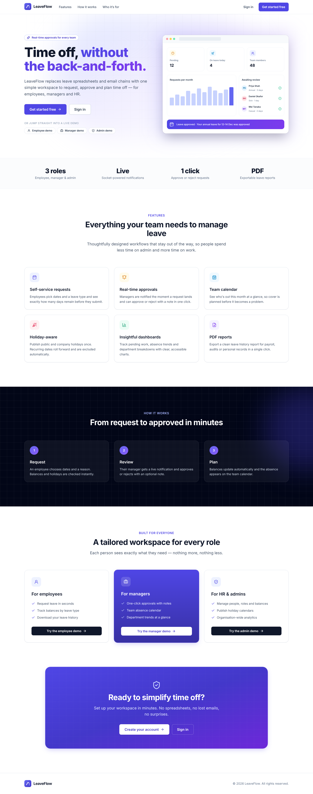
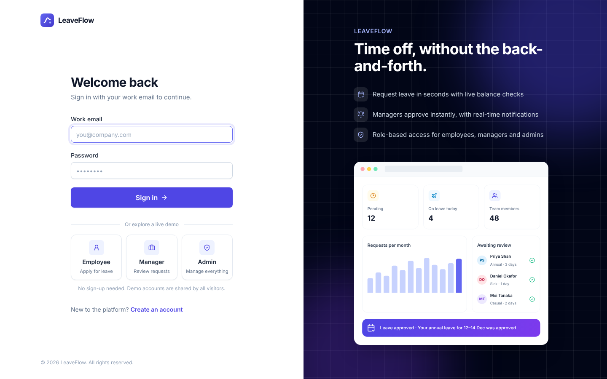
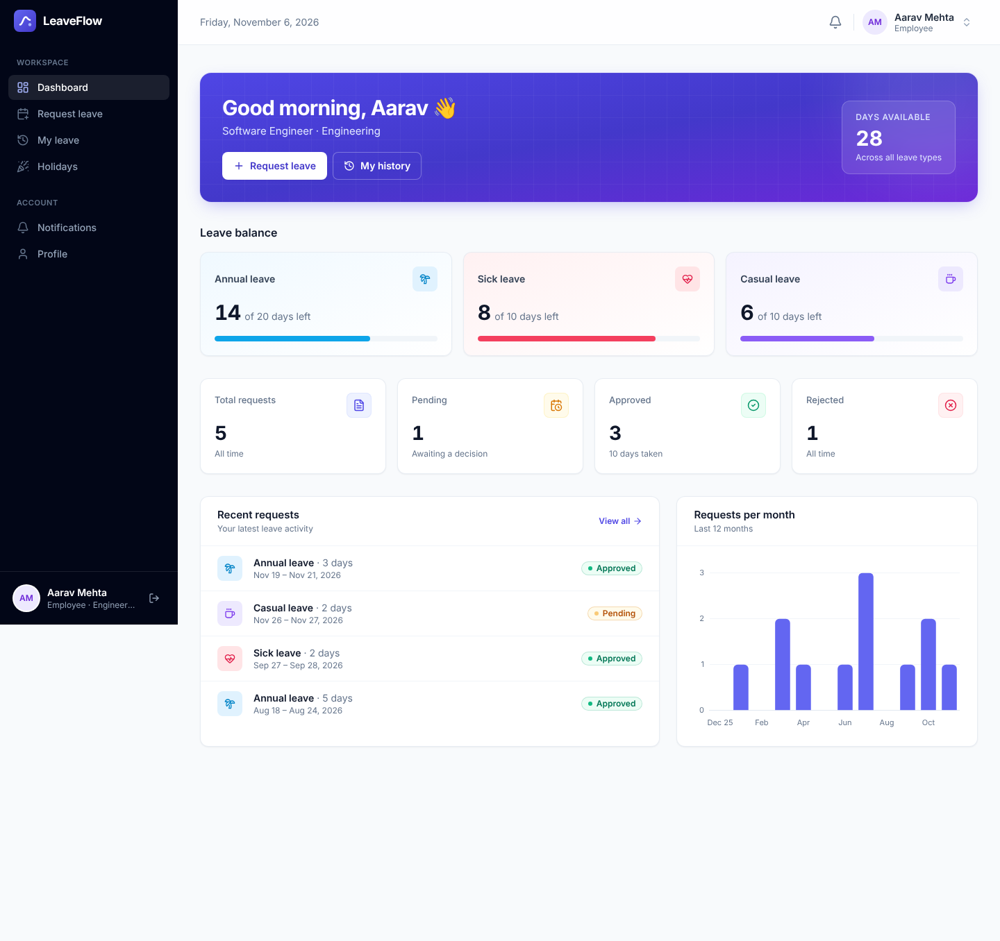
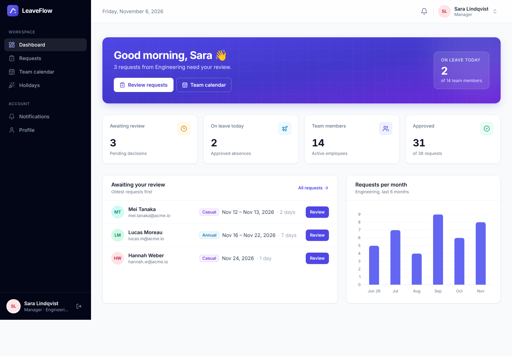
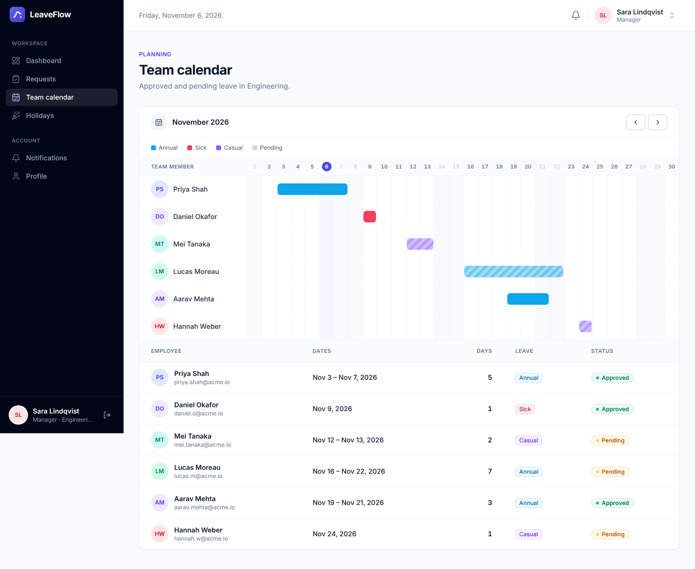
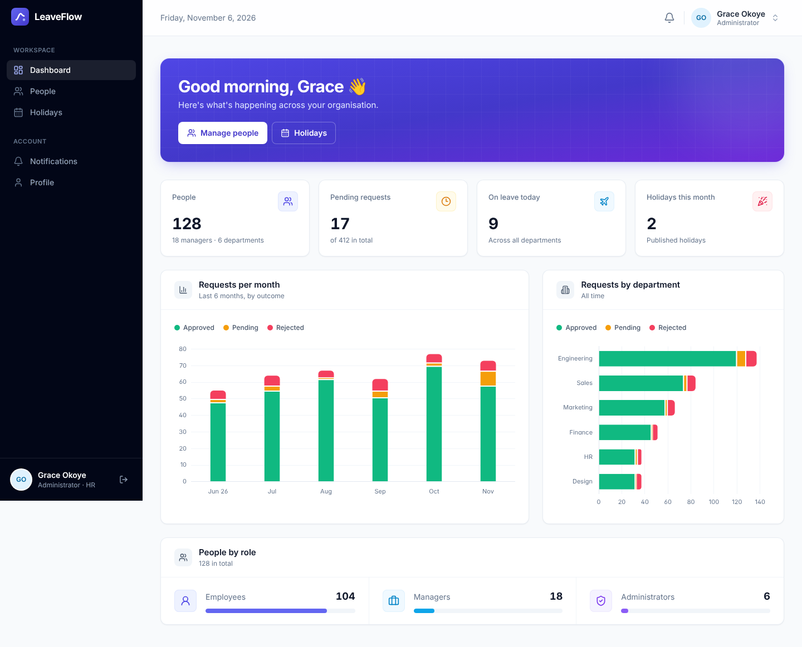

# Online Leave Management System (MERN)

A leave request and approval system for organisations. Employees request leave, managers approve or reject requests from their department, and administrators manage people and the holiday calendar.

## Screenshots

| Landing page | Sign in |
| --- | --- |
|  |  |
| **Employee dashboard** | **Manager dashboard** |
|  |  |
| **Team calendar** | **Admin overview** |
|  |  |

The product name shown in the UI defaults to **LeaveFlow**; set `VITE_APP_NAME` in the client environment to white-label it.

## Features

**Employees**
- Request annual, sick or casual leave; the form shows the day count and the balance left after approval
- Track every request and its outcome, filter by status, and export the history as a PDF
- See the holiday calendar (leave can't be requested on holidays)

**Managers**
- Review pending requests from their department, with the requester's current balance, and add a note
- Team calendar of approved and pending leave by month
- Department statistics

**Administrators**
- Create, edit, deactivate and delete accounts; assign roles and departments
- Manage holidays, including holidays that repeat every year
- Organisation-wide statistics

**Platform**
- JWT authentication with role-based access enforced on the server
- Self-registration always creates an employee account; manager and admin roles are granted by an administrator
- Leave balances are deducted atomically on approval, so concurrent approvals can't overdraw a balance
- Optional realtime notifications (Socket.IO) and login alert emails (Gmail SMTP)

## Tech stack

| Layer | Technology |
| --- | --- |
| Client | React 18, TypeScript, Vite, Redux Toolkit, React Router 7, Tailwind CSS, Formik + Yup, Chart.js |
| Server | Node.js, Express, express-validator, Mongoose |
| Database | MongoDB |
| Realtime | Socket.IO (authenticated with the same JWT) |
| Tests | Node test runner (server, against a real MongoDB), Vitest + Testing Library (client) |

## Project structure

```
client/
  src/
    components/   shared UI (ui/), layout, charts, leave and holiday components
    pages/        one folder per area: auth, dashboard, leave, team, holidays, users, ...
    services/     http client, typed API functions, realtime connection
    store/        Redux store (auth session, notifications)
    lib/          dates, formatting, constants, validation rules
    hooks/        data loading helpers
server/
  routes/         auth, leaves, holidays, users, admin (statistics)
  models/         User, LeaveRequest, Holiday
  middleware/     authentication/authorisation, validation, error handling
  services/       holiday expansion (recurring holidays), notifications
  validators/     request validation shared between routes
  tests/          unit and API integration tests
  scripts/        createAdmin.js, checkAdmin.js
```

## Getting started

### 1. Install

```bash
cd server && npm install
cd ../client && npm install
```

### 2. Configure

`server/.env`

```env
MONGODB_URI=mongodb://127.0.0.1:27017/leave-management
JWT_SECRET=a-long-random-string          # required; the server will not start without it
PORT=5000
CLIENT_URL=http://localhost:5173         # optional; comma-separated list of allowed origins
GMAIL_USER=                              # optional; enables login alert emails
GMAIL_PASS=                              # Gmail app password
```

`client/.env`

```env
VITE_APP_API_URL=http://localhost:5000/api   # defaults to /api (proxied to localhost:5000 in development)
VITE_APP_SOCKET_URL=http://localhost:5000    # optional; realtime notifications are off when unset
```

### 3. Create the first administrator

```bash
cd server
ADMIN_EMAIL=you@company.com ADMIN_PASSWORD=choose-a-password npm run create-admin
```

### 4. Run

```bash
cd server && npm run dev     # API on http://localhost:5000
cd client && npm run dev     # app on http://localhost:5173
```

## Scripts

| Location | Command | Purpose |
| --- | --- | --- |
| server | `npm test` | Unit and API integration tests. Starts a temporary `mongod` (from PATH or `MONGOD_PATH`), or uses `TEST_MONGODB_URI`. |
| server | `npm run create-admin` | Create or repair an administrator account |
| client | `npm run dev` | Development server |
| client | `npm run build` | Type-check and build for production |
| client | `npm test` | Vitest suite |
| client | `npm run lint` / `npm run typecheck` | ESLint / TypeScript checks |

## Deployment notes

- The server exports the Express app for serverless hosting (Vercel). Serverless functions can't hold WebSocket connections, so leave `VITE_APP_SOCKET_URL` unset there; everything else works without realtime. To get realtime notifications, run the server as a long-lived Node process.
- Set `JWT_SECRET`, `MONGODB_URI` and `CLIENT_URL` in the hosting environment.

## API overview

| Method | Path | Access |
| --- | --- | --- |
| POST | `/api/auth/register`, `/api/auth/login` | Public |
| GET | `/api/auth/me` | Signed in |
| GET | `/api/leaves` | Signed in (own / department / all, by role) |
| POST | `/api/leaves` | Employee |
| PATCH | `/api/leaves/:id` | Manager of the request's department |
| GET | `/api/leaves/employee/stats`, `/api/leaves/manager/stats` | Signed in / Manager |
| GET | `/api/holidays?year=` | Signed in |
| POST, PATCH, DELETE | `/api/holidays[/:id]` | Admin |
| GET, POST, PUT, DELETE | `/api/users[/:id]` | Admin |
| GET | `/api/admin/stats` | Admin |

Errors are returned as `{ "message": "...", "errors": [{ "field": "...", "message": "..." }] }`.

## Contact

**Developer:** Mantu
**Email:** [mantukumar87586299@gmail.com](mailto:mantukumar87586299@gmail.com)
**GitHub:** [github.com/Mantu008](https://github.com/Mantu008)
